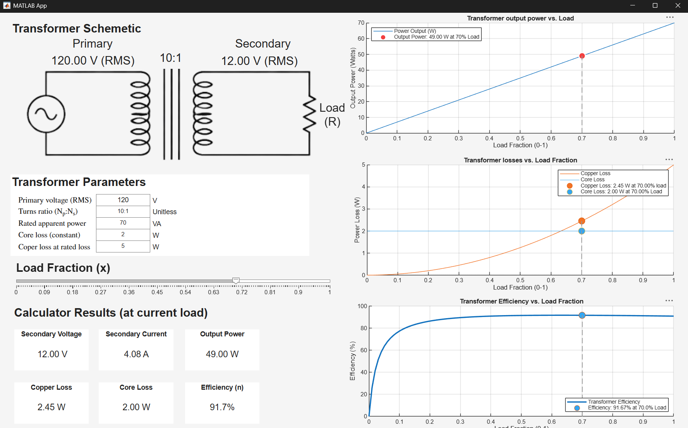

# Transformer-Load-and-Efficiency-Explorer

A MATLAB App Designer project for calculating and visualizing transformer performance at different load levels.

The app uses a simplified transformer model to calculate secondary voltage, current, output power, copper loss, core loss, and efficiency.

## Preview

### Features
Adjustable primary voltage, turns ratio, and rated apparent power.

Custom core loss and rated copper loss values.

Load slider from 0% to 100%.

Live calculations and graphs.

Output power vs. load.

Core and copper losses vs. load.

Efficiency vs. load.

Input validation for invalid values.

### Project files
transformerApp.mlapp - Main App Designer project

TransformerMath.m - Original MATLAB calculations

transformerApp.mltbx - Installable app package, available under Releases
